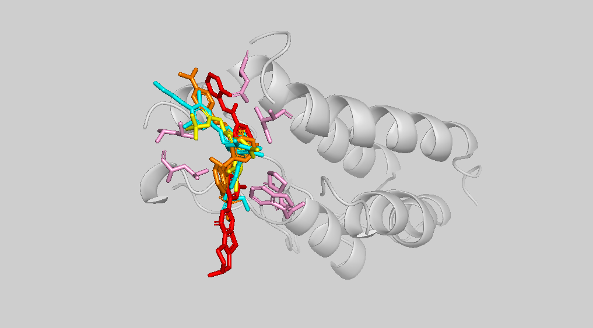

# GNN予測活性の構造的妥当性検証 — DiffDockによるBRD4ドッキング解析

作成日: 2026年10月12日（2026年10月24日 更新: 全数値を再計算し、出どころとなるコードを付録に追記）
対象: BRD4化合物活性予測パイプラインの追加検証

---

## 要約

機械学習モデル（GNN）が「この化合物はBRD4によく結合する」と予測したとき、その予測が構造的に筋の通ったものかを、独立した手法で確かめた。

GNNは化合物を**2次元の分子構造図**として見ており、立体的な形は一切見ていない。一方でドッキング（DiffDock）は、タンパク質の立体構造の中に化合物を実際に配置してみる手法である。異なる見方をする2つの手法が同じ結論に至るなら、予測の確からしさは増す。

結果として、**当初想定していた検証指標は機能しなかった**。「既知の阻害剤と同じアミノ酸に接触しているか」で判別しようとしたが、活性が低い化合物も同じアミノ酸に接触したため、区別がつかなかった。代わりに、化合物がポケットのどれだけ奥まで安定して収まるかに差が現れ、その順序は実験で測定された活性値の順序と一致した。

あわせて、GNNが立体異性体（活性体と不活性体）を区別できないという限界が明らかになった。

検証は5条件に留まるため、統計的な主張はできない。本文では、言えることと言えないことを分けて記述する。

---

## 1. 背景と目的

### 1.1 何を検証したいのか

本パイプラインのGNNは、化合物のSMILESを入力として、BRD4に対する活性値（pIC50）を予測する。検証データ（Val）1,336件に対する精度は以下の通りである。

| 指標 | 値 |
|---|---|
| Pearson相関係数 | 0.841 |
| R²（決定係数） | 0.705 |
| MAE | 0.447 |
| RMSE | 0.605 |

数値としては良好だが、これは「数字が当たっている」ことしか示さない。**モデルが化合物の何を見て高活性と判断したのかは、この数値からは分からない。** そこで、GNNが高活性と予測した化合物について、構造生物学の観点から妥当性を確認する。

### 1.2 「結合するか」の検証ではない

選定した化合物はすべてChEMBL由来で、実験で測定された活性値を持つ。結合することは既に分かっており、計算で結合の有無を証明することもできない（それにはITC、SPR、共結晶構造解析などの実験が必要である）。

検証したいのは次の点である。

> GNNの予測が、既知の阻害剤と同様の構造的根拠を伴っているか

---

## 2. 対象と手法

### 2.1 BRD4 BD1ドメイン

BRD4はヒストンのアセチル化リジンを認識するブロモドメインを持ち、この認識ポケットに結合する化合物がBET阻害剤として開発されている。

本検証では、BRD4第1ブロモドメイン（BD1）とBET阻害剤 **JQ1** の結晶構造 **PDB 3MXF** を用いた。タンパク質には、本パイプラインの特徴量抽出で作成した `brd4_bd1_simple.pdb`（チェーンA、残基44–168）をそのまま使用した。

### 2.2 DiffDock

DiffDockは、タンパク質構造と化合物のSMILESから、ポケット内での化合物の立体配置（ポーズ）を予測する拡散モデルである（Corso et al., ICLR 2023）。本検証では改良版のDiffDock-Lを使用した。動かすのは化合物の位置・向き・ねじれ角の3つで、タンパク質側の構造は固定される。

**confidence scoreについて**: DiffDockは各ポーズに confidence score を出力する。これは「このポーズが正解構造からRMSD 2 Å未満に収まっているか」を別のモデルで判定した対数オッズである。**結合親和性ではない**ため、pIC50と直接比較してはならない。

実行にはGoogle Colab（NVIDIA T4 GPU）を用いた。手順はColabノートブックに記録している。

### 2.3 接触残基の解析

DiffDockの出力ポーズをタンパク質構造と結合し、別リポジトリで構築済みの構造解析パイプライン（`Protein_Interaction_Analysis.ipynb`）で接触残基を解析した。算出した指標は以下の通りである。

- **BSA（埋没表面積）**: リガンドの有無で各残基の溶媒接触表面積を計算し、その差を取る。「その残基がリガンドにどれだけ覆われたか」を面積で表す。BSAが1.0 Ųを超える残基を「接触残基」とした。
- **最短原子間距離**: 残基とリガンドの全原子の総当たりで最小値を取る

---

## 3. 陽性対照による指標の校正

### 3.1 なぜ陽性対照が必要か

5章では、検証対象の化合物をDiffDockのconfidence scoreで比較する。しかし検証対象には結合状態の立体構造がないため、予測されたポーズが正しいかを直接確かめられない。頼れるのはconfidence scoreだけだが、この値には「いくつ以上なら良い」という確立された基準がない。

そこで本番の前に、**正解の結合ポーズが分かっている化合物で、confidence scoreが物差しとして機能するかを確かめる**。用いたのは3MXFに含まれるJQ1である。3MXFからJQ1を除いたポケットと、JQ1のSMILESだけをDiffDockに渡し、予測ポーズが結晶構造中のJQ1の位置をどれだけ再現できるかを調べた（リドッキング）。SMILESは原子座標を含まないため、DiffDockは正解を見ずに形と位置を予測することになる。検証対象の化合物もSMILESから入力するため、条件は本番と揃っている。

### 3.2 立体異性体の取り違えとその発見

JQ1には鏡像異性体があり、**(S)体が活性本体、(R)体はほぼ不活性**である。当初、陽性対照として入力したSMILESを確認したところ、(R)体になっていた。RCSBの化学成分辞書で3MXF収載のJQ1が(6S)体であることを確かめ、(S)体で再実行した。

その結果、rank1（confidenceが最も高いポーズ）のconfidenceは、(R)体の−1.95から(S)体の **+0.63** に変わった。(S)体では10回のサンプリングがすべて正の値（+0.26〜+0.63）に収まった。

### 3.3 RMSDによる検証

(S)-JQ1の10ポーズそれぞれについて、結晶構造中のJQ1とのRMSD（各原子が正解の位置から平均で何Åずれているか）を測定した。タンパク質は3MXFの座標をそのまま用いているため、予測ポーズと結晶構造は同じ座標系にある。リガンド同士を重ね合わせると「ポケット内の違う場所に置かれた」という誤りが見えなくなるため、重ね合わせは行わず、その場の座標のまま比較した。

- **10ポーズすべてがRMSD 2 Å未満**（0.51〜1.51 Å）であり、ドッキングで慣例的に用いられる成功基準を満たした
- **rank1のRMSDは0.62 Å**で、結晶構造の結合様式をほぼ再現した。検証対象の化合物では正解がないためrank1のポーズを採用するしかなく、そのrank1が正しかったことが実用上最も重要な確認である
- confidenceの順位とRMSDの順位の相関（スピアマンの順位相関係数）は **ρ = −0.75** であった。confidenceは大きいほど、RMSDは小さいほど良いため、負の値は「confidenceが高いポーズほど正解に近い」ことを意味する。**この系においてconfidence scoreがポーズの正しさを反映している**ことを実測で確認できた

### 3.4 陽性対照から言えることの限界

DiffDockの訓練データはPDBBindの2018年以前の複合体であり、2010年登録の3MXFは**訓練データに含まれていると考えられる**。RMSD 0.62 Åという良好な値は、予測能力ではなく記憶を反映している可能性がある。

また、ρ = −0.75は、すべてRMSD 2 Å未満のポーズ、いわば正解圏内のポーズ同士の順序を比べた結果である。confidenceが負になるような外れたポーズでも同様の対応があるかは確認できていない。

したがって、陽性対照の意義は、入力の作り方とパイプラインが正しく動作することの確認と、confidenceが正の領域ではポーズの正しさを反映することの確認に限定される。

---

## 4. 検証対象の選定

### 4.1 選定条件

Val 1,336件から、以下の条件で化合物を選定した。

1. 検証データであること（GNNが学習時に見ていない）
2. ドッキング適性: 重原子28〜48個、回転可能結合3〜11本（JQ1と同程度の扱いやすさ。回転可能結合はRDKit標準の定義で数えた）
3. 立体中心なし、重水素標識なし（扱いを単純に保つため）

条件を満たす候補は461件であった。

### 4.2 選定された化合物

「高活性だから当然ポケットに入るのではないか」という疑問に答えるため、対照を加えた以下の4条件とした。

| ラベル | 役割 | 予測pIC50 | 実測pIC50 | Val内順位 | 重原子 | 回転結合 |
|---|---|---|---|---|---|---|
| JQ1_S | 陽性対照（結晶構造あり） | — | — | — | 31 | 3 |
| top_pred | 予測高・実測高 | 9.29 | 9.37 | 1位 | 44 | 10 |
| fp_highpred | 予測高・実測低（モデルの失敗例） | 8.14 | 5.76 | 59位 | 48 | 11 |
| neg_true | 予測低・実測低（真の陰性） | 5.46 | 5.46 | 1127位 | 41 | 6 |

- **top_pred**: 条件を満たす候補の中で予測pIC50が最も高く、実測も9.37と高い（Val全体の予測2位は、分子量853のペプチド型プロドラッグで選定条件を満たさない）
- **fp_highpred**: GNNがIC50換算で約240倍の過大評価をした化合物。ドッキングがこの誤りを検出できるかを確認する
- 対照2化合物の選定結果は、候補から次の規則で再現できる。fp_highpredは「実測pIC50 < 6の中で予測pIC50が最大」、neg_trueは「予測pIC50 < 6の中で予測誤差が最小」

### 4.3 化合物間の類似性

「top_predがJQ1に似ているから同じ結果になったのではないか」という可能性を確かめるため、Morganフィンガープリント（半径2、2048ビット）によるTanimoto係数を算出した。

| 比較 | Tanimoto係数 |
|---|---|
| JQ1 vs top_pred | **0.113** |
| top_pred vs 訓練データ（最大） | 0.846 |
| JQ1 vs 訓練データ（最大） | 0.903 |

JQ1（チエノトリアゾロジアゼピン系）とtop_pred（ベンゾフラン-ピリジノン系）の類似度は0.113であり、**構造的には別系統の骨格**である。

一方、top_predは訓練データ内に0.7以上の類縁体を9件持ち、9件すべてpIC50 8.6以上（8.67〜9.26）の高活性化合物である。**GNNはこの化合物の近縁体を学習時に見ており、予測が当たったこと自体は難易度の高いタスクではなかった可能性がある**（6.3節）。

---

## 5. 結果

### 5.1 confidence scoreの比較

| 化合物 | confidence (rank1) | 10ポーズの範囲 | 実測pIC50 |
|---|---|---|---|
| JQ1_S（陽性対照） | +0.63 | +0.63 〜 +0.26 | — |
| top_pred | −0.39 | −0.39 〜 −3.61 | 9.37 |
| fp_highpred | −1.10 | −1.10 〜 −5.10 | 5.76 |
| neg_true | −2.60 | −2.60 〜 −4.55 | 5.46 |

実測pIC50の降順（9.37 → 5.76 → 5.46）と、confidenceの降順（−0.39 → −1.10 → −2.60）が**一致した**。

### 5.2 接触残基の比較 — 当初の指標は機能しなかった

JQ1の接触残基（14残基）を基準に、各化合物の重複を調べた。

| 化合物 | 接触残基数 | JQ1と共通 | 共通率 | 合計BSA (Ų) |
|---|---|---|---|---|
| JQ1_S | 14 | 14 | 100% | 335.2 |
| top_pred | 18 | 14 | 100% | 391.9 |
| fp_highpred | 18 | 14 | 100% | 436.3 |
| neg_true | 16 | 12 | 86% | 322.1 |

BET阻害剤の結合に重要とされる主要残基へのBSA（Ų）は以下の通りである。

| 化合物 | Trp81 | Pro82 | Leu92 | Leu94 | Ile146 | Asn140 |
|---|---|---|---|---|---|---|
| JQ1_S | 38.6 | 29.5 | 62.8 | 32.6 | 39.6 | 24.8 |
| top_pred | 38.6 | 29.5 | 62.9 | 38.6 | 33.7 | 29.1 |
| fp_highpred | 58.0 | 29.5 | 64.0 | 31.4 | 38.4 | 29.4 |
| neg_true | 44.7 | 27.2 | 51.9 | **12.1** | 29.0 | 31.5 |

**ここで当初の想定が崩れた。** 実測pIC50が5.46の低活性化合物も、主要残基すべてに接触していた。接触残基の一致は、活性の高低を判別する指標として機能しない。

これは構造生物学的には自然な結果である。アセチルリジン認識ポケットの形状は決まっており、そこに収まる分子は必然的に同じ残基群と接する。

### 5.3 差が現れた箇所 — 結合の深さ

| 化合物 | confidence | 実測pIC50 | (S)-JQ1ポーズからの重心ズレ | Leu94 BSA |
|---|---|---|---|---|
| top_pred | −0.39 | 9.37 | 0.80 Å | 38.6 |
| fp_highpred | −1.10 | 5.76 | 1.21 Å | 31.4 |
| neg_true | −2.60 | 5.46 | 3.42 Å | 12.1 |

4化合物すべてが同一ポケットに配置されたが、neg_trueだけはJQ1から3 Å以上ずれ、Leu94への接触も他の3分の1程度で、**ポケットの奥まで入りきれていない**。4ポーズの重ね合わせ図（`overlay_4poses.png`）でも、neg_true（赤）のみが他の化合物から下方向にはみ出している。

黄: (S)-JQ1（陽性対照）、シアン: top_pred、オレンジ: fp_highpred、赤: neg_true、ピンク: JQ-1が結合するBRD4の主要残基

重心ズレの基準は、DiffDockが予測した(S)-JQ1のrank1ポーズである。結晶構造中のJQ1を基準にしても、値は0.92 / 1.17 / 3.32 Åで順序は変わらない。ただし、top_predとfp_highpredの差（0.3〜0.4 Å）は、(S)-JQ1の10ポーズのばらつき（RMSD 0.51〜1.51 Å）と同程度である。明確に言えるのは、neg_trueのずれのみである。

### 5.4 fp_highpredの位置づけ

GNNが8.14（高活性）と予測し、実測は5.76だった化合物について、DiffDockはtop_predと区別できない配置を予測した。JQ1の接触残基14残基すべてに接触し、合計BSAは4条件中で最大、(S)-JQ1ポーズからの重心ズレ（1.21 Å）もtop_pred（0.80 Å）との差がポーズのばらつきの範囲内であった。差が現れたのはconfidenceのみで、−1.10とtop_pred（−0.39）とneg_true（−2.60）の中間であった。**ドッキングは、GNNのこの過大評価を明確には検出できなかった。** ポケットに収まることと強く結合することは別であり、ポーズに基づく指標では両者を区別できないことを示す例である。

また、confidenceの差についても解釈には注意が要る。**n=1であり、偶然の可能性を排除できない**。この化合物は4条件中で最も大きく柔軟（重原子48、回転結合11）であり、スコアが低い理由が活性の低さなのか分子の扱いにくさなのかを分離できない。一方、neg_trueはtop_predより扱いやすい分子（重原子41・回転結合6）にもかかわらず最低スコアであり、こちらは分子サイズでは説明できない。

---

## 6. 言えること、言えないこと

### 6.1 言えること

- (S)-JQ1について、DiffDockは結晶構造をRMSD 0.62 Åで再現し、この系でconfidenceはポーズの正しさを反映した（ρ = −0.75）
- 4条件において、実測pIC50の順序とconfidenceの順序が一致した
- 構造的に無関係な骨格（Tanimoto 0.113）の2化合物が、同一ポケットに同様の接触パターンで配置された
- 低活性のneg_trueのみ、ポケットの奥まで入りきれていなかった
- 立体異性体の違いが、confidenceに明確な差（−1.95 と +0.63）として現れた

### 6.2 言えないこと

- **統計的な主張**: n=5であり、順序の一致が偶然でない保証はない
- **confidence値の絶対的評価**: RMSDで検証できたのは正の領域のみで、負の領域でconfidenceとRMSDがどう対応するかは未検証である
- **親和性の予測**: confidence scoreは親和性ではない。pIC50との比較は順序の観察に留まる
- **GNNの予測能力の証明**: 妥当なポーズが得られることは裏付けの一つであり、証明ではない

### 6.3 本検証で明らかになった限界

**訓練データの重複**: 3MXFはDiffDockの訓練データに含まれると考えられ、陽性対照の良好な結果は記憶を反映している可能性がある。

**GNN側の類縁体**: top_predは訓練データ内に最大Tanimoto 0.846の類縁体を持つ。予測が当たったのは、訓練データに近い領域での予測だったためと考えられる。これは今後追加するApplicability Domain判定機能で扱う課題そのものである。

**立体化学の非認識**: 本GNNの原子特徴量は`[原子番号, 結合数, 水素数, 電荷, 芳香族性, 混成軌道]`の6次元であり、キラリティを含まない。確認したところ、(S)-JQ1と(R)-JQ1は`smiles_to_graph`を通すとノード特徴量・エッジ・結合種別・記述子のすべてが完全に一致した。**活性体と不活性体がモデルには同一の入力として見えている。** 実際に学習済みGNNに通すと、両者の予測pIC50はともに7.06で、完全に一致した。

同じ2分子に対して、ドッキングは+0.63と−1.95という明確な差を出した。2次元のグラフ表現では原理的に区別できない差を、3次元の手法は区別できたことになる。ChemPropなどが原子特徴量にキラリティタグを含めるのはこのためである。10月中の完成を優先し、本件は限界の明記に留め、特徴量の拡張と再学習は行わなかった。

**物理的妥当性の未検証**: PoseBusters（Buttenschoen et al.）は、深層学習ベースのドッキング手法がRMSDでは良好でも物理的に妥当でない構造（原子の衝突など）を生成する場合があると報告している。本検証では結合長や立体衝突の観点からの検証を行っていない。

---

## 7. 今後の展開

- **規模の拡大**: confidenceと実測活性の関係を傾向として示すには、予測高群・低群それぞれ20〜30件規模で、分子サイズと回転可能結合数を群間で揃えた比較が必要である
- **立体化学の導入**: 原子特徴量にキラリティタグを追加した再学習により、立体異性体を判別できるかを検証する
- **Applicability Domain**: 訓練データとの類似度に基づき、予測の信頼性を提示する。本検証で浮上した「訓練データに類縁体が存在する範囲での予測」という限界に直接対応する

---

## 付録: 再現のためのファイル

### 数値の出どころ

| 数値 | コード |
|---|---|
| GNNの精度（1.1節） | `diffdock_support.ipynb` セル1 |
| 選定条件・Val内順位・選定規則（4.1〜4.2節） | `diffdock_support.ipynb` セル2・2b |
| Tanimoto類似度（4.3節） | `diffdock_support.ipynb` セル3 |
| 立体異性体の入力と予測値の一致（6.3節） | `diffdock_support.ipynb` セル4 |
| 重心ズレ（5.3節） | `diffdock_support.ipynb` セル5、`Protein_Interaction_Analysis.ipynb` |
| DiffDock実行・confidence・RMSD（3節、5.1節） | diffdock_colab.ipynb |
| 接触残基・BSA（5.2〜5.3節） | `Protein_Interaction_Analysis.ipynb`（構造解析リポジトリ） |
| 4ポーズ重ね合わせ図 | PyMOLで作成 |

`diffdock_support.ipynb`は、学習ノートブックのVal抽出セルが保存する`val_predictions.csv`と、このフォルダのDiffDockの出力を読み込む。セル4のみ、学習ノートの特徴量セルで作るbrd4_cpi_dataset.ptが必要である。

### 再現時の注意

学習済みモデルで推論するときは、分子記述子（`global_feat`）を学習時の統計量（`global_scaler.pt`）で標準化する必要がある。`brd4_cpi_dataset.pt`は標準化前の状態で保存されており、標準化を省くとPearson相関が0.841から−0.309へと符号ごと反転する。
